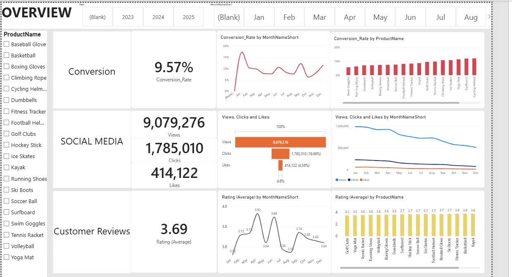
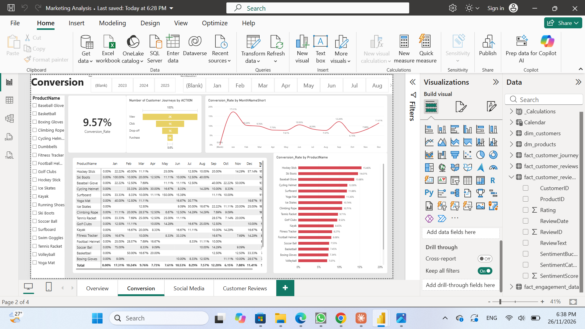
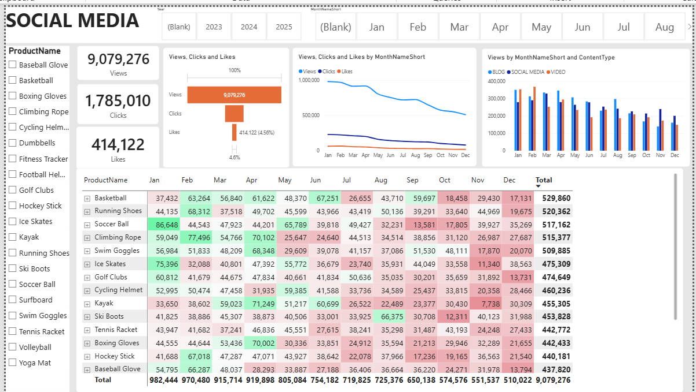
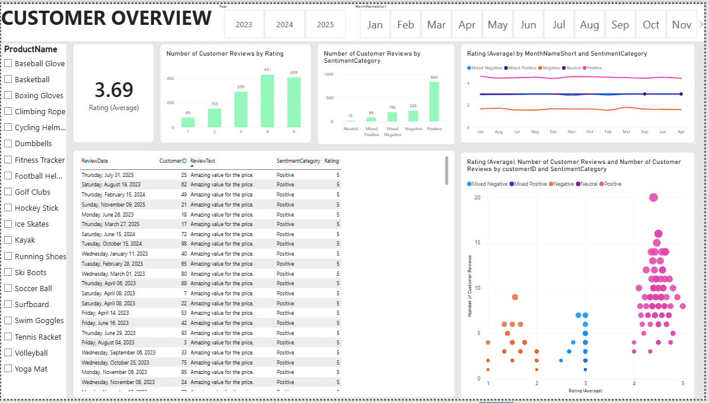

# ShopEasy Marketing Analytics | SQL · Python · Power BI

**Problem:** ShopEasy's customer engagement and conversion rates fell even though it spent more on marketing.

**Goal:** Find where customers drop off, which content works best, and what customers say in their reviews.

## What I did
- **SQL Server:** cleaned and prepared customer, product, engagement and review data
- **Python:** sentiment analysis on customer reviews (VADER)
- **Power BI:** data model, DAX measures and a 4-page dashboard (Overview, Conversion, Social Media, Reviews)

## Key insights
- 74% of customers who reached checkout left without buying; overall conversion was 9.6% and fell from 11.6% (2023) to 8.6% (2025)
- Content views dropped 78% over 3 years (5.0M → 1.1M), and the click rate fell from 25% to 6% across all channels
- Average rating was 3.69/5; the top complaint was price ("Not worth the money", ~170 reviews), followed by unclear instructions

## Dashboard

*Guided project based on Ali Ahmad's Marketing Analytics tutorial.*
